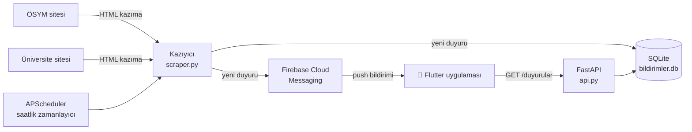

[README.md](https://github.com/user-attachments/files/34599891/README.md)
# 🔔 Bildirim Uygulaması

Üniversite ve sınav kurumu duyurularını **tek bir uygulamada toplayan** ve yeni bir duyuru yayınlandığında telefona **anlık bildirim gönderen** mobil uygulama ile arka uç (backend) sistemi.

---

## 📌 Neden yazıldı?

Öğrenciler önemli duyuruları (sınav tarihleri, başvuru süreleri, bölüm/fakülte duyuruları) birden fazla web sitesini tek tek kontrol ederek takip etmek zorunda kalıyor. Bu siteler çoğunlukla bildirim göndermiyor; duyuru kaçırılınca başvuru ya da sınav fırsatı kaçabiliyor.

Bu proje bu sorunu şöyle çözer:

- Duyuruları kaynak sitelerden **otomatik olarak** toplar,
- Aynı duyuruyu iki kez göndermemek için **tekrar kontrolü** yapar,
- Yeni bir duyuru bulunca kullanıcının telefonuna **push bildirimi** gönderir,
- Tüm duyuruları uygulamada **tek bir listede, kaynağa göre sekmelenmiş** halde gösterir.

Şu an takip edilen kaynaklar:

| Kaynak | Adres |
|---|---|
| ÖSYM | `osym.gov.tr` – Duyurular |
| Bursa Uludağ Üniversitesi – Gemlik | `uludag.edu.tr/gemlik` – Duyurular |

Uygulama ayrıca kullanıcıların **yeni site önerebilmesine** izin verir: eklenmek istenen sitenin RSS altyapısı varsa doğrulanır, yoksa "özel altyapı gerekiyor" talebi olarak kaydedilir.

---

## 🧱 Nasıl çalışır?



1. **Zamanlayıcı** belirli aralıklarla (varsayılan: saatte bir) kazıyıcıyı çalıştırır.
2. **Kazıyıcı** kaynak sitelerin duyuru sayfalarını indirip ayrıştırır.
3. Her duyurunun linki veritabanında aranır; **yoksa** kaydedilir ve Firebase üzerinden bildirim gönderilir.
4. **Flutter uygulaması** `/duyurular` endpoint'inden listeyi çeker ve gösterir; bildirime tıklanınca duyuru linkini açar.

---

## 🛠️ Kullanılan teknolojiler

### Mobil uygulama
| Teknoloji | Kullanım amacı |
|---|---|
| **Flutter / Dart** | Android, iOS, web ve masaüstü için tek kod tabanından arayüz |
| **Firebase Cloud Messaging (FCM)** | Telefona push bildirimi alma |

### Arka uç (backend)
| Teknoloji | Kullanım amacı |
|---|---|
| **Python 3** | Ana dil |
| **FastAPI** | REST API (`/duyurular`, `/site-ekle`, `/tetikle`, `/saglik`) |
| **Uvicorn** | ASGI sunucusu |
| **Requests + BeautifulSoup4** | Web sayfalarını indirme ve HTML ayrıştırma (web scraping) |
| **feedparser** | RSS/Atom kaynaklarını doğrulama |
| **SQLite** | Duyuruların ve site taleplerinin saklanması |
| **APScheduler** | Arka planda periyodik kontrol (cron benzeri) |
| **firebase-admin** | Sunucudan FCM bildirimi gönderme |
| **Pydantic** | Gelen verinin doğrulanması |
| **SlowAPI** | İstek sınırlama (rate limiting) |

### Dağıtım
| Teknoloji | Kullanım amacı |
|---|---|
| **Render** | Arka ucun barındırılması |
| **GitHub** | Sürüm kontrolü |

---

## 🔌 API uç noktaları

| Metot | Adres | Açıklama | Koruma |
|---|---|---|---|
| `GET` | `/duyurular?limit=250` | Kayıtlı duyuruları yeniden eskiye listeler | Dakikada 60 istek |
| `POST` | `/site-ekle` | Yeni site önerisi gönderir; RSS varsa doğrular, yoksa talep olarak kaydeder | Dakikada 5 istek |
| `POST` | `/tetikle` | Taramayı elle başlatır (yönetici) | `X-API-Key` başlığı + saatte 6 istek |
| `GET` | `/saglik` | Sunucunun ayakta olup olmadığını kontrol eder | – |

**Örnek yanıt (`/duyurular`):**

```json
[
  {
    "site_adi": "ÖSYM",
    "baslik": "Örnek duyuru başlığı",
    "link": "https://www.osym.gov.tr/...",
    "tarih": "10.11.2026"
  }
]
```

---

## 📁 Proje yapısı

```
bildirim-api/
├── api.py            # FastAPI uygulaması, zamanlayıcı, uç noktalar
├── scraper.py        # Kaynak sitelerden duyuru çekme + bildirim gönderme
├── db.py             # Ortak veritabanı bağlantısı ve şema
├── requirements.txt  # Python bağımlılıkları
├── .env.example      # Gerekli ortam değişkenleri (örnek)
├── lib/              # Flutter uygulama kodu
├── android/ ios/ web/ windows/ linux/ macos/   # Flutter platform klasörleri
├── assets/           # Uygulama görselleri
├── test/             # Testler
└── pubspec.yaml      # Flutter bağımlılıkları
```

---

## 🚀 Kurulum

### 1) Arka uç

```bash
git clone https://github.com/sevvalBilgi22/bildirim-api.git
cd bildirim-api

python -m venv .venv
source .venv/bin/activate        # Windows: .venv\Scripts\activate
pip install -r requirements.txt

cp .env.example .env             # değerleri doldur (aşağıya bak)
uvicorn api:app --reload
```

API varsayılan olarak `http://127.0.0.1:8000` adresinde çalışır.

**Ortam değişkenleri**

| Değişken | Açıklama |
|---|---|
| `TELEFON_TOKEN` | Bildirimin gönderileceği cihazın FCM token'ı |
| `FIREBASE_CREDENTIALS_JSON` | Firebase servis hesabı JSON içeriği (veya `FIREBASE_CREDENTIALS_PATH` ile dosya yolu) |
| `ADMIN_API_KEY` | `/tetikle` endpoint'i için gizli anahtar |
| `ALLOWED_ORIGINS` | (Opsiyonel) Yalnızca web istemcisi için izinli adresler, virgülle ayrılmış |
| `DB_PATH` | (Opsiyonel) Veritabanı dosya yolu |
| `KONTROL_ARALIGI_SAAT` | (Opsiyonel) Otomatik tarama aralığı, varsayılan `1` |
| `ENABLE_DOCS` | (Opsiyonel) `1` yapılırsa `/docs` sayfası açılır |

> ⚠️ **Gizli bilgileri asla commit etme.** `firebase-admin.json`, `.env` ve `*.db` dosyaları `.gitignore` içinde olmalıdır.

### 2) Firebase

1. [Firebase Console](https://console.firebase.google.com)'da bir proje oluştur.
2. **Project Settings → Service accounts** bölümünden yeni bir özel anahtar (JSON) üret.
3. JSON içeriğini `FIREBASE_CREDENTIALS_JSON` değişkenine koy.
4. Flutter uygulamasını Firebase projesine bağla (`google-services.json` / `GoogleService-Info.plist`).

### 3) Mobil uygulama

```bash
flutter pub get
flutter run
```

### 4) Render'da yayınlama

- **Build command:** `pip install -r requirements.txt`
- **Start command:**
  ```
  uvicorn api:app --host 0.0.0.0 --port $PORT --proxy-headers --forwarded-allow-ips="*"
  ```
- Ortam değişkenlerini Render panelindeki **Environment** bölümüne gir.
- Tek worker kullan (zamanlayıcı her worker'da ayrı çalışmasın diye).

---

## 🔒 Güvenlik önlemleri

- **SSRF koruması:** Kullanıcının verdiği URL'ler sunucuda getirilmeden önce doğrulanır; iç ağ, `localhost` ve bulut metadata adresleri engellenir, yönlendirmeler ve yanıt boyutu sınırlandırılır.
- **Kimlik doğrulama:** Yönetici uç noktaları gizli API anahtarı ister.
- **Rate limiting:** Tüm halka açık uç noktalarda istek sınırı vardır.
- **Gizli bilgi yönetimi:** Token ve Firebase kimlik bilgileri koda değil ortam değişkenlerine yazılır.
- **Link doğrulama:** Bildirimlere yalnızca izinli alan adlarındaki `https` linkleri eklenir.
- **Girdi doğrulama:** Pydantic ile uzunluk ve tür kontrolü yapılır.
- **Hata mesajları:** İç hata detayları istemciye gösterilmez, yalnızca sunucu log'una yazılır.

---

## ⚠️ Bilinen sınırlamalar

- Bildirimler şu an **tek bir cihaza** gönderilmektedir; çok kullanıcılı yapı için token kayıt sistemi gerekir.
- Veritabanı olarak SQLite kullanılır; Render'ın ücretsiz planında disk kalıcı değildir. Kalıcı disk veya PostgreSQL önerilir.
- Kazıma, kaynak sitelerin HTML yapısına bağlıdır; site tasarımı değişirse kazıyıcının güncellenmesi gerekir.

---

## 🗺️ Gelecek planları

- [ ] Çok kullanıcılı bildirim desteği (cihaz token kaydı)
- [ ] Kullanıcının takip edeceği kaynakları seçebilmesi
- [ ] Yeni kaynak sitelerin eklenmesi (RSS destekli siteler için otomatik)
- [ ] PostgreSQL'e geçiş
- [ ] Duyuru arama ve filtreleme

---

## 👩‍💻 Geliştirici

**Şevval Ülkü Bilgi** — [@sevvalBilgi22](https://github.com/sevvalBilgi22)

---

## 📄 Lisans

Bu proje eğitim amaçlı geliştirilmiştir. Lisans bilgisi eklenecektir.
